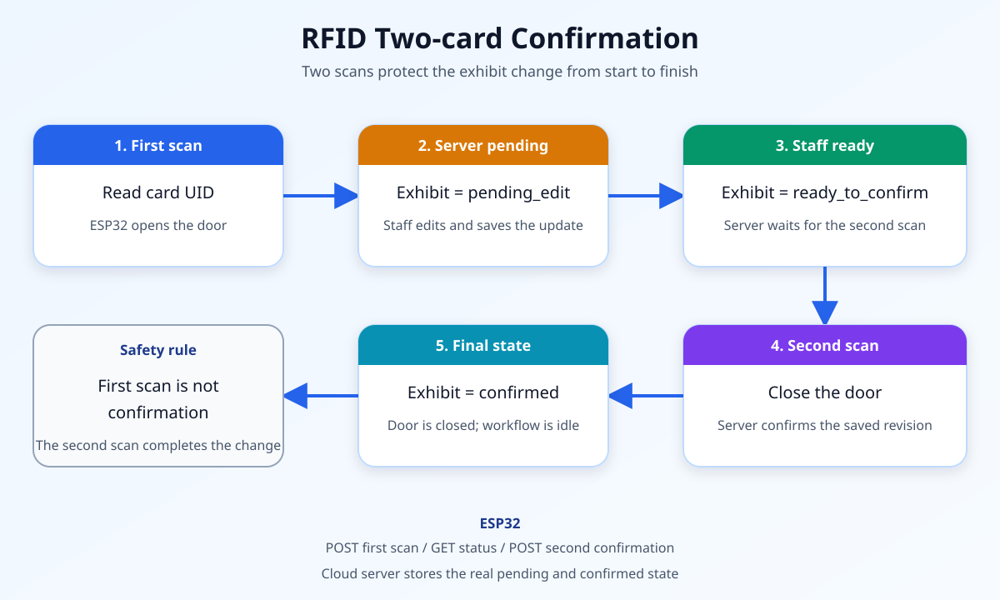
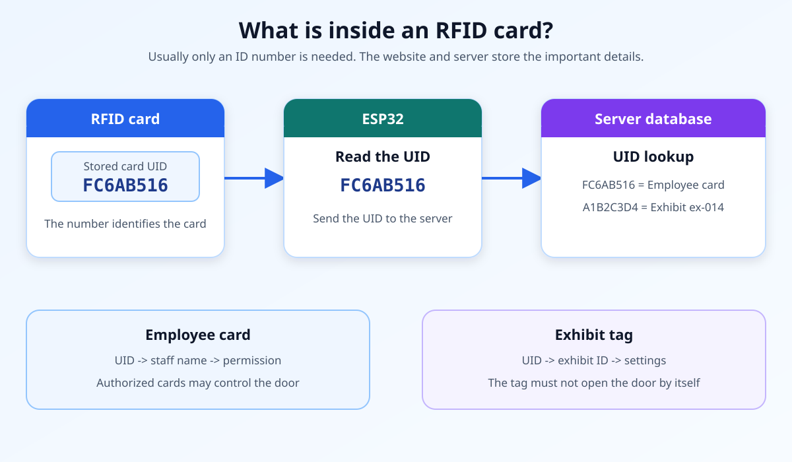

# NO-PUSH Explaination

## The newest thing: an RFID door controlled by ESP32



We are using the new RFID card function directly on the ESP32.

```text
        RFID card
           |
           v
        ESP32
       /      \
      v        v
  Open door   Send event to server
```

## Simple flow

1. Put an RFID card near the reader.
2. ESP32 reads the card UID.
3. ESP32 checks whether the UID is allowed.
4. If allowed:
   - the door relay switches on;
   - the door stays open for 3 seconds;
   - the ESP32 tells the server about the accepted card.
5. If not allowed:
   - the door remains closed;
   - the ESP32 tells the server about the denied card.

## What changed

### Before

```text
RFID -> Arduino -> USB cable -> Computer -> Python bridge -> Server
```

The computer had to remain connected.

### Now

```text
RFID -> ESP32 -> Wi-Fi -> Server
```

The ESP32 can work without a computer.

## What ESP32 needs

- Wi-Fi name
- Wi-Fi password
- Server address
- One allowed RFID UID

The values are placeholders until they are entered:

```cpp
const char wifiSsid[] = "YOUR_WIFI_NAME";
const char wifiPassword[] = "YOUR_WIFI_PASSWORD";
const char serverUrl[] = "https://192.168.1.100:8000/api/rfid/access-event";
```

## Server event

The ESP32 sends a small JSON message:

```json
{
  "uid": "FC6AB516",
  "result": "accepted",
  "door": "opened"
}
```

The local Python server receives it at:

```text
/api/rfid/access-event
```

## What are GET and POST?

GET and POST are two ways for ESP32, a browser, or a Python server to talk.

```text
ESP32 / Browser ---> GET  ---> Server
ESP32 / Browser ---> POST ---> Server
```

### GET: ask for information

GET means:

> “Server, please give me the latest information.”

Example in this project:

```text
GET /api/rfid/status
```

The ESP32 sends a GET request every second. The server responds with the current workflow:

```json
{
  "phase": "ready_to_confirm",
  "uid": "FC6AB516",
  "exhibit_id": "ex-014"
}
```

GET is used to receive status. It should not change the RFID workflow by itself.

### POST: send new information

POST means:

> “Server, please receive this new information or command.”

The ESP32 sends a POST after RFID events:

```text
POST /api/rfid/access-event
```

Example body:

```json
{
  "uid": "FC6AB516",
  "result": "accepted",
  "door": "opened",
  "phase": "first_scan_pending"
}
```

The staff member or server also sends a POST to tell ESP32 that editing is finished:

```text
POST /api/rfid/staff-ready
```

Example body:

```json
{
  "manual_update_finished": true
}
```

### Simple comparison

| Method | Question it asks | Used here for |
|---|---|---|
| GET | What is the current status? | ESP32 reads `pending_edit`, `ready_to_confirm`, or `idle` |
| POST | Please process this new event or change. | First scan, second scan, staff-ready update |

### Where they are written

```text
ESP32 sends GET and POST:
hardware/hardware.ino

Python server receives them:
server.py
```

In `hardware/hardware.ino`:

- `HTTPClient.GET()` calls `GET /api/rfid/status`
- `HTTPClient.POST(payload)` calls `POST /api/rfid/access-event`

In `server.py`:

- `do_GET()` handles status requests
- `do_POST()` handles RFID and staff-ready requests

## Small vocabulary

| Word | Meaning |
|---|---|
| UID | The unique number printed inside an RFID card by the card |
| Relay | An electrical switch that the ESP32 controls |
| Wi-Fi | How ESP32 talks to the server |
| JSON | A simple text format used to send information |
| POST | A message from ESP32 to the server |
| venv | A separate Python environment; not needed for the ESP32 RFID function |

## What is inside an RFID card?



An RFID card usually stores its own unique UID, such as `FC6AB516`. It does not
normally store exhibit names, staff names, door passwords or editing history.

```text
RFID card -> ESP32 reads UID -> server looks up UID -> find card type
```

| Card type | Server information connected to the UID |
|---|---|
| Employee card | Staff name, staff ID and door permission |
| Exhibit tag | Exhibit ID, exhibit name and edit settings |

This keeps important information on the server. A card only identifies itself.

## NO-PUSH meaning

This document only explains the work. It does not:

- upload files;
- create a commit;
- push code to GitHub;
- change cloud deployment.

## Two-card workflow for changing an exhibit

```text
First card scan
      |
      v
ESP32 opens the door
      |
      v
Server sets the exhibit to PENDING

Staff member edits the exhibit on the server
      |
      v
Server marks the edit READY TO CONFIRM

Second card scan
      |
      v
ESP32 closes the door
      |
      v
Server marks the exhibit CONFIRMED
```

## Manual staff workflow without backend profile updates

For the current prototype, the employee performs the physical or profile work
by hand. The website does not automatically update the exhibit database and
does not need to upload a generated profile by itself.

```text
ESP32 first scan
      |
      v
ESP32 notifies the employee
      |
      v
Employee manually updates the exhibit profile
      |
      v
Employee clicks "Updated" in the website
      |
      v
Website/ESP32 waits for the second scan
      |
      v
Employee scans the same exhibit tag again
      |
      v
ESP32 confirms the manual update
```

This version is different from a fully automated exhibit editor:

| Item | Manual prototype |
|---|---|
| Exhibit ID | Selected from the first ESP32 scan; employees do not type it |
| Profile update | Employee updates it manually outside the backend workflow |
| Website update | No automatic database or profile write is required |
| Ready confirmation | Employee clicks a button or tells ESP32 that the work is finished |
| Second scan | Confirms that the physical update is complete |
| Backend revision | Not required by the current manual workflow |

### First scan

1. ESP32 reads the exhibit RFID tag.
2. ESP32 sends a notification to the employee.
3. ESP32 opens the door or activates its current physical action.
4. The employee knows which exhibit must be updated.

The employee does not search for a server-side edit form or enter an Exhibit ID.

### Employee manually updates the profile

The employee may:

- change a paper label;
- replace a physical display item;
- update an information board by hand;
- manually change a profile in an external system;
- prepare a model or image without linking it to the current prototype database.

The RFID workflow does not verify or record the details of this manual work.
The employee's click means only:

> “I finished the manual update for this exhibit.”

### Employee confirms the update

The employee clicks a button such as **Mark updated** or **Send to ESP32**.
The website can change its visible state to:

```json
{
  "phase": "ready_to_confirm",
  "uid": "FC6AB516",
  "exhibit_id": null
}
```

The exact Exhibit ID is still hardware-authoritative and may remain visible from
the first scan. The employee must not edit it.

In a frontend-only demonstration, the confirmation button may only change
browser state. In a hardware-connected demonstration, ESP32 must receive the
ready notification before expecting the second scan.

### Second scan

1. The employee scans the same exhibit tag again.
2. ESP32 checks that the same UID belongs to the same pending workflow.
3. ESP32 confirms that the manual update is complete.
4. ESP32 closes the door or ends the physical action.
5. The workflow returns to idle.

The second scan means **“the employee has finished the manual update.”** It does
not mean that a backend profile write or 3D asset upload occurred.

```text
First scan  -> employee receives notification
Manual work -> employee updates the profile or exhibit by hand
Ready       -> employee clicks the confirmation button
Second scan -> ESP32 confirms the manual workflow
Idle        -> workflow can start again
```

### What happens at the first scan

1. The RFID card is read.
2. The server receives the card UID.
3. The server finds which exhibit belongs to that change.
4. The exhibit state changes to `pending`.
5. The ESP32 opens the door.

The first scan means: **“someone is now changing this exhibit.”**

### What happens on the server

For the manual workflow, the server does not need an exhibit edit page:

1. It receives the first RFID event.
2. It identifies the pending exhibit by the ESP32-provided UID and Exhibit ID.
3. It waits for the employee's manual-ready action.
4. It waits for the matching second RFID event.

No exhibit information is written automatically. The exhibit should stay in
`pending` while manual work is unfinished.

### What happens after manual confirmation

The server sends a confirmation-ready message to the ESP32.

At this point, the exhibit is ready to be confirmed, but it must not be confirmed until the second card scan.

### What happens at the second scan

1. The ESP32 receives the same matching card.
2. The server asks whether the exhibit is still ready to confirm.
3. If ready, the ESP32 closes the door.
4. The server changes the exhibit state from `pending` to `confirmed`.

The second scan means: **“the physical work is finished, and the exhibit change is confirmed.”**

## Simple state

| State | Door | Exhibit |
|---|---|---|
| Idle | Closed | No pending edit |
| First scan | Open | `pending` |
| Staff editing | Open | `pending` |
| Confirmation sent | Open | `ready-to-confirm` |
| Second scan | Closed | `confirmed` |

The server must not confirm an exhibit only because the first card was scanned.

### What each phase means

| Phase | Meaning | Next action |
|---|---|---|
| `idle` | No exhibit manual update is active. | ESP32 waits for the first matching scan. |
| `pending_edit` | The first scan selected an exhibit and opened the work area. | The employee performs the manual update. |
| `ready_to_confirm` | The employee marked the manual update finished. | ESP32 waits for the same UID to scan a second time. |

The phases describe a physical manual workflow, not a backend data update:

```text
idle
  -> first scan
pending_edit
  -> employee finishes work and clicks confirmation
ready_to_confirm
  -> same UID scans again
idle
```

`pending_edit` means the employee is now expected to update or maintain the
physical exhibit. `ready_to_confirm` means the employee has reported that the
manual work is finished. The second RFID scan provides the final physical
confirmation.

Exhibit ID is provided by the ESP32/server for the scanned UID. Employees
must not type it or change it. Revision is not required for this manual workflow
because no new backend exhibit version is being created automatically.

## Suggested server messages

First scan:

```json
{
  "phase": "first_scan",
  "uid": "FC6AB516",
  "exhibit_id": "ex-014",
  "action": "open_and_pending"
}
```

Server sends confirmation-ready message:

```json
{
  "phase": "staff_ready",
  "exhibit_id": "ex-014",
  "action": "wait_for_second_scan"
}
```

Second scan:

```json
{
  "phase": "second_scan",
  "uid": "FC6AB516",
  "exhibit_id": "ex-014",
  "action": "close_and_confirm"
}
```

These JSON formats are a plan. The real server routes and authentication must be added before deployment.

## Use a cloud server

If the project already has a real cloud server, ESP32 does not need to talk to a computer.

```text
ESP32 -> Internet/Wi-Fi -> Cloud server -> Database
```

The ESP32 should use the cloud server address:

```cpp
const char serverUrl[] =
  "https://your-cloud-server.com/api/rfid/access-event";

const char rfidStatusUrl[] =
  "https://your-cloud-server.com/api/rfid/status";
```

Fill in:

| Place | What to fill |
|---|---|
| `wifiSsid` | The normal Wi-Fi name |
| `wifiPassword` | The Wi-Fi password |
| `serverUrl` | Cloud event API URL |
| `rfidStatusUrl` | Cloud status API URL |
| `allowedRfidUid` | The card UID used to open and confirm |

### Local test

```text
ESP32 -> Computer Wi-Fi -> Python server.py
```

Use an address such as:

```cpp
"http://192.168.1.100:8000/api/rfid/access-event"
```

### Cloud test

```text
ESP32 -> Internet -> Cloud server
```

Use an address such as:

```cpp
"https://reshow.example.com/api/rfid/access-event"
```

This project already uses this CloudFront server address:

```text
https://dkbznu9f5nh9n.cloudfront.net
```

The ESP32 has been given these planned cloud API paths:

```text
POST https://dkbznu9f5nh9n.cloudfront.net/api/rfid/access-event
GET  https://dkbznu9f5nh9n.cloudfront.net/api/rfid/status
POST https://dkbznu9f5nh9n.cloudfront.net/api/rfid/staff-ready
```

At the moment, the website Cloud Lambda implements `/api/health` and the Cloudflare
AI generator only. The three RFID cloud routes are not active yet. The ESP32 will
receive `404 Not Found` until a lightweight cloud RFID server adds the routes.

### What should not be filled

Do not use the website page address:

```text
https://your-server.com/#overview
```

Use API paths:

```text
POST /api/rfid/access-event
GET  /api/rfid/status
POST /api/rfid/staff-ready
```

### Current local implementation

Current `server.py` is enough for local testing:

- it runs on one computer;
- it exposes the local RFID status and action routes;
- it stores the short workflow in memory;
- it does not need a database for model generation or four-view generation.

The local server is a lightweight communication service between ESP32, browser
and the prototype UI. It is not an exhibit database.

## Independent 3D studio prototype

For the current project, generating four views and a 3D model does not require an
exhibit database. The generation workflow can stay entirely inside the browser or
local 3D and AI studio:

```text
Upload four photos or one exhibit image
        |
        v
3D or image-generation service
        |
        v
Preview GLB model or four-view images
        |
        v
Download files to the employee's computer
```

The employee can therefore do the following without a backend database:

1. upload front, back, left and right photographs;
2. generate four views or a GLB preview;
3. inspect the result in Three.js;
4. download the generated files;
5. manually place or use the files where the demonstration requires them.

This architecture is suitable for a prototype because it separates three concerns:

```text
Frontend generation: create and preview assets
ESP32 workflow: identify the exhibit and confirm manual work
Manual staff work: inspect, copy, replace or operate exhibits
```

It does not require employees to ask a backend developer for:

- an exhibit file table;
- a revision table;
- an object-storage upload API;
- a generated-asset database record;
- cloud signed download URLs;
- automatic profile updates;
- an asset status webhook.

### When a database becomes necessary

Only add a database later when the project needs persistent automation, such as:

- storing generated models for several users;
- opening the same exhibit data after another browser restart;
- automatic assignment of generated files to an exhibit;
- version history and rollback;
- cloud access for many devices;
- audit logs or staff accounts;
- automatic synchronization with a showcase website.

Before those features exist, a database would only add complexity and would not
make the prototype more useful.

### Current recommended responsibilities

| Part | Current responsibility |
|---|---|
| 3D and AI studio | Generate, preview and download models or images |
| Browser | Show the current RFID phase and manual confirmation button |
| `server.py` | Relay local RFID workflow status while testing |
| ESP32 | Read UID, open/close the door and report scans |
| Employee | Perform the manual update and report that it is finished |
| Database | Not required for the current prototype |

### Current combined prototype

```text
Four photos
    -> local or external generation
    -> preview/download
    -> employee manually updates the exhibit
    -> RFID first scan and second scan confirm the manual action
```

The RFID workflow does not automatically know whether a model was generated or
where it was downloaded. That association can be added in a later database-backed
version if the system later needs automated asset management.

## RC522 events through Mega and ESP32

The `hardware_updated/hardware_updated.ino` sketch now reads cards with an RC522
connected to an Arduino Mega and sends each scan as one JSON line over `Serial2`.
The ESP32 bridge in `NO-PUSH-explaination/wifi_updated/wifi_updated.ino` forwards
those RFID event lines to its configured HTTP test endpoint, prioritizing them
ahead of periodic sensor readings.

### Mega-to-RC522 wiring

Use the Mega's hardware SPI pins:

| RC522 | Arduino Mega |
|---|---|
| SDA / SS | 53 |
| SCK | 52 |
| MOSI | 51 |
| MISO | 50 |
| RST | 49 |
| VCC | 3.3V only |
| GND | GND |
| IRQ | Leave unconnected |

RC522 signals are 3.3V logic. Arduino Mega GPIO outputs are 5V, so use a
3.3V-compatible logic-level shifter between the Mega and RC522 signal pins; do
not power the RC522 from 5V.

### Mega-to-ESP32 serial wiring

The existing sketches use 9600 baud:

```text
Mega TX2 (pin 16) -> level shifter -> ESP32 GPIO18 (RX)
Mega RX2 (pin 17) <- level shifter <- ESP32 GPIO17 (TX)
Mega GND           ---------------- ESP32 GND
```

The level shifter protects the ESP32 from the Mega's 5V TX signal. Both boards
may use their own USB power while testing; connect their grounds together.

### What a scan sends

The Mega prints an event to its `Serial2` port. An allowlisted card is associated
with the configured demo exhibit; other card UIDs are reported as denied:

```json
{
  "type": "rfid_event",
  "uid": "FC6AB516",
  "result": "accepted",
  "exhibit_id": "helmet-001"
}
```

Change `allowedRfidUid` and `rfidExhibitId` in the Mega sketch to match the demo
card and exhibit. The current reader reports scans only: it does not operate a
door relay or perform the full first-scan/staff-ready/second-scan workflow.
Install the `MFRC522` Arduino library before compiling the Mega sketch. The
ESP32 still sends data to its configured HTTP endpoint; this does not connect
the event to the ReShow website or database.
