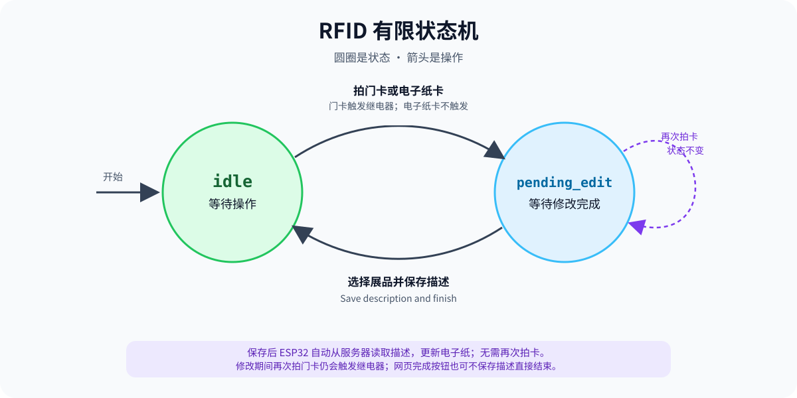

# ReShow

A desktop demonstration dashboard for a reusable smart exhibition showcase. Built with HTML, CSS, plain JavaScript ES modules, and a standard-library Python server. The showcase demo needs no build step, framework, package installation or hardware communication. Live website account administration uses the existing AWS Cognito and staff API services. The 3D studio loads the included Three.js r128 and GLTFLoader files. Production serves static files from EC2 through CloudFront and routes the studio API to a separate Python Lambda function over HTTPS.

## Run locally

Use Python 3.14 or later. Open PowerShell in this project directory and run:

```powershell
python server.py
```

Stop any previously running local web server first, then open **http://127.0.0.1:8000** in a desktop browser. If port 8000 is occupied by another application, use `python server.py --port 8001` and open **http://127.0.0.1:8001**. The default mode is plaintext HTTP for local development and does not show a self-signed certificate warning. For optional local HTTPS, provide both `--cert-file` and `--key-file`; use a certificate trusted by the browser and whose subject alternative names include `127.0.0.1` or `localhost`. The server hosts the dashboard and its local showcase API together; do not open `index.html` directly because browsers restrict ES modules on `file:` URLs. Press Ctrl+C in the server terminal to stop it.

Staff sign-in is configured for the production website using the exact `/auth/callback.html` path. The previous HTTP localhost callback is retained in the account configuration, but the local server now requires HTTPS; a trusted HTTPS local callback must be explicitly configured in Cognito and the client allowlist before local staff sign-in can work. PKCE state/verifier expire after ten minutes in sessionStorage; access and refresh tokens remain in memory and are cleared on logout or expiry. Other demo origins can use the local showcase without staff sign-in.

Use the same origin/port to keep saved demo records. Data is stored in that browser's `localStorage`; it is not shared with a server. If storage is unavailable, an on-screen warning explains that changes are held in memory.

## Explore the seven tabs

- **Overview:** confirmed showcase status, environmental readings, assigned exhibit, actual acknowledged label, lighting requests, heatmap, and recent events.
- **Exhibits:** search/filter, create/edit profiles and limits, simulate an exhibit-tag scan, confirm assignment, and inspect illustrative model metadata.
- **Labels:** edit the live monochrome preview, choose a local image, save a draft, and separately request delivery. The previously acknowledged label remains visible until delivery succeeds.
- **Activity:** filter by Hong Kong dates and exhibit, switch heatmap measures, inspect cells with mouse or keyboard, and filter the event log.
- **Reports:** choose sections and filters, generate a stored preview, export its CSV, or use **Print / Save as PDF**. In a regular browser, choose a PDF destination in the print dialog. This is browser printing, not a direct PDF download.
- **Staff access:** sign in through Cognito for live website account administration. An Administrator can manage live invitations, roles and account status. The separate expandable browser-local demo edits sample staff/cards and historical accepted/denied attempts; these sample roles and cards do not grant live website access.
- **3D & AI studio:** switch between the 3D model studio, Image & AI (including Tripo), and ESP32/RFID workflow; one section is shown at a time. Explore and adjust the 3D model, import a `.glb` or a trusted JavaScript module exporting a `THREE.Group`, `THREE.Object3D`, or `THREE.Scene`, export four hologram views, and generate exhibit JSON from the included `assets/helmet.jpg` photo or another selected image. Locally this tab uses the same Python server as the rest of the site; the deployed site uses its same-origin HTTPS API.

Expand or collapse **Model settings** to show or hide model import, zoom, lighting, and rotation speed controls. Use the X and Y rotation speed sliders to change how many radians the bunny or currently loaded model rotates per animation frame. Set an axis to zero to stop it, or use a negative value to reverse it. The pause/resume button, dragging the viewer, and the front/side/back camera buttons remain available.

Three.js module imports use this ES module contract:

```js
export default function createModel(THREE) {
  const group = new THREE.Group();
  // Add meshes and materials to group.
  return group;
}
```

Alternatively, export the object as `createModel`, `createGroup`, `default`, or
`model`. Only import `.js` or `.mjs` modules from trusted sources because the
module executes in the browser. `.ts` files are not directly executed by the
canvas; compile TypeScript to JavaScript first.

The **3D & AI studio** tab keeps exhibit JSON generation in the **Image-to-JSON assistant**. The separate **Tripo 3D generation** section accepts a Tripo API key for the current page session. It sends the key and prompt or selected image to the same-origin API, which forwards them to Tripo; they are not saved. Use only HTTPS or localhost, and do not paste the key into chat or source code. The key is held in the browser while the page is open, not exclusively on the server.

Tripo generates a standard textured PBR model from the selected image (currently about $0.30 per task). After the image task succeeds, its ID is filled in as the source for text-guided retexturing (currently about $0.10 per task). You can enter a previous image-generation task ID as the source; keep that ID for further retexturing, since a retexture task has its own ID. Check [Tripo API pricing](https://developers.tripo3d.ai/en/pricing) before submitting; prices may change. The resulting GLB is loaded into the viewer when possible, and a temporary download link is provided. If direct loading fails, download and import the GLB. Model links expire after about five minutes. Generation continues if the page closes; retain the task ID and use **Check existing task** rather than submitting again. If submission fails before an ID is received, check Tripo task history before retrying because the request may already have been accepted. API credits and payment are separate from an App Store subscription.

For Workers AI, enable the `@cf/meta/llama-3.2-11b-vision-instruct` model and accept any required model terms in Cloudflare before generating. Review the [model license](https://github.com/meta-llama/llama-models/blob/main/models/llama3_2/LICENSE) and [acceptable use policy](https://github.com/meta-llama/llama-models/blob/main/models/llama3_2/USE_POLICY.md) before using it. Images are processed in memory and are not saved.

There is no Settings tab or remote unlock action. Layouts target desktop widths of 1280, 1440 and 1920 pixels. Exhibit illustrations are local editable SVG assets; model metadata in the Exhibits tab is illustrative.

## Local RFID exhibit-change workflow

The [Mega sketch](hardware_updated/hardware_updated_RFID_lock/hardware_updated_RFID_lock.ino)
reads cards and controls the relay and e-paper; the [ESP32 bridge](NO-PUSH-explaination/wifi_updated/wifi_updated_RFID/wifi_updated_RFID.ino)
sends events to the local server:

```text
RFID card -> Mega -> ESP32 -> Wi-Fi -> local server
                  <- ESP32 <- RFID status
```

Configure card roles in the Mega sketch's `rfid_cards.h` and the ESP32's Wi-Fi and local RFID URL in the bridge sketch.

For local testing, ESP32 and the computer running `server.py` can be on the same
ordinary Wi-Fi or phone hotspot:

```text
ESP32 -> http://computer-ip:8000 -> server.py
```

For cloud testing, ESP32 should call HTTPS CloudFront/Lambda APIs. `server.py` is
only a local development server; it is not the production database.

GET and POST have different jobs:

| Method | Meaning | ReShow RFID use |
|---|---|---|
| GET | Read saved description or status | ESP32 periodically reads `/api/rfid/epaper-description`; an e-paper scan reads status if no description has been saved |
| POST | Submit a new event or command | ESP32 posts scans; the webpage saves a description or finishes the workflow |

A GET request should not itself change an exhibit. A POST request should validate
the card, phase, exhibit and revision before changing server state.

The school network may use enterprise or captive-portal authentication that ESP32
cannot use directly. A phone hotspot or normal router is easier for local testing.
Do not commit Wi-Fi passwords or device secrets to GitHub.

The local workflow uses one start scan:



In the 3D & AI studio's ESP32/RFID section, expand **Card roles and workflow help** to read the card and state descriptions.

```text
Door card or e-paper card
  -> door card triggers the Mega relay for 3 seconds
  -> e-paper card does not trigger the relay; both RGB LEDs turn green for about 1 second
  -> server state: pending_edit

Staff selects an existing exhibit in the RFID panel and edits its description
  -> Save description and finish
  -> server state: idle
  -> ESP32 polls the server and sends the description to the Mega
  -> e-paper updates automatically (no second scan)
```

The green LEDs confirm that the Mega recognized an e-paper card locally, not that the server or e-paper has updated. Normal lighting resumes after the indication.

The description must be 1–180 printable English characters; the current display font does not support Chinese. The website stores the exhibit profile in browser-local demo storage. The server separately persists the most recently published e-paper description in a local ignored file; if server publication fails after the profile is saved, the page reports the partial failure and the description can be retried while the session is pending. The fixed hardware exhibit ID is not a website exhibit ID, so staff must explicitly select the correct website exhibit.

The ESP32 checks the saved description about every 10 seconds, forwards changes to the Mega, and retries if the update fails; unchanged text is not repeatedly displayed. The Mega acknowledges after updating the display, and the ESP32 reports that confirmation to the server. The webpage shows whether confirmation is still pending or was last received; this is not a live connection or visual check. If either board restarts, the ESP32 sends the saved text again. Before any description is saved, the e-paper card displays the workflow status instead. A configured `edit` card or a direct `POST /api/rfid/staff-ready` still finishes a pending edit without publishing a description; the webpage no longer offers a separate button for this. Subsequent start scans during a pending edit do not replace the active workflow, although a door card still triggers the relay locally. The local workflow and confirmation are stored in server memory and reset when the server restarts; the saved description survives a server restart and is confirmed again by the ESP32. It is not an authenticated production API; use only a trusted network.

For local testing without cards, the **3D & AI studio** RFID panel has **Test door card** and **Test e-paper card** buttons. Press either, select an exhibit, and save its description; the status moves from `idle` to `pending_edit` and back to `idle`. These simulated taps change shared server state but do not operate hardware. Restart the local server and upload both updated Mega and ESP32 sketches before testing the physical display. The ESP32 must use the computer's current reachable LAN address in its RFID URL.

The [Mega RFID-lock sketch](hardware_updated/hardware_updated_RFID_lock/hardware_updated_RFID_lock.ino) also shows a startup test on a GDEH0154D67 e-paper display, then puts it to sleep. Install **GxEPD2** and **Adafruit GFX Library** in Arduino Library Manager, in addition to the sketch's existing libraries. Connect CS=43, DC=41, RST=39, BUSY=37, DIN=MOSI=51, and CLK=SCK=52; share ground. RFID and e-paper share SPI but use separate chip selects. Before connecting a 5 V Mega, verify that the specific Waveshare driver board supports 5 V signals and supply; older boards require 3.3 V and level shifting.

The Mega sketch also supports an I2C SSD1306 128x64 OLED for local temperature and relative light readings and warnings, rotated 90 degrees counterclockwise. `T` is temperature and `L` is relative light. Install **Adafruit SSD1306** and **Adafruit GFX Library** using Arduino Library Manager. Connect SDA to Mega SDA (pin 20), SCL to SCL (pin 21), and ground to ground. Check the OLED module's supply and I2C voltage requirements before wiring: a 3.3 V-only module needs appropriate power and level shifting for the Mega. The sketch checks addresses 0x3C and 0x3D and reports initialization errors in the 115200 baud serial monitor. Readings and warnings refresh with the existing sensor sampling interval (currently 30 seconds); warnings use the existing fixed limits immediately, not the proposal's sustained-duration logic.

For the local server demonstration, an `epaper` card sends an event then requests the current server RFID phase. The ESP32 returns that phase to the Mega, which displays it on the e-paper; this is a status demonstration, not exhibit data. A card with an empty role is denied. Connect Mega TX2 (pin 16) through a 5 V-to-3.3 V level shifter to ESP32 GPIO18, ESP32 GPIO17 to Mega RX2 (pin 17), and common ground; level-shift the latter to 5 V for guaranteed Mega input levels. Upload both sketches, configure the ESP32 RFID URL to the computer's LAN IP, and run `server.py --bind 0.0.0.0` only on a trusted network; the local RFID API has no production authentication. Allow the chosen port through the firewall if necessary. Restart the local server after code changes.

For the `wifi` card in the Mega sketch, upload both that sketch and the ESP32 RFID bridge. A scan queues a fixed test message without the UID for POST to the bridge's httpbin URL, not the ReShow RFID endpoint or door relay. View the ESP32 serial monitor at 115200 baud for the HTTP status and echoed response; queued events are processed at most once per 10 seconds, and a disconnected network or earlier failed event can delay the test. The public HTTP endpoint is unencrypted: never send secrets or private information. httpbin echoes the POST immediately; it does not save it for a later GET.

For cloud testing, the ESP32 constants use:

```text
https://dkbznu9f5nh9n.cloudfront.net/api/rfid/access-event
https://dkbznu9f5nh9n.cloudfront.net/api/rfid/status
https://dkbznu9f5nh9n.cloudfront.net/api/rfid/staff-ready
```

These RFID routes are not yet implemented by the deployed Cloud Lambda. `/api/health`
and the Cloudflare AI generator are the currently known active cloud routes.

### Cloud Lambda implementation checklist

The backend team should implement the following before allowing ESP32 to use the cloud routes:

1. Add `GET /api/rfid/status` and return the current workflow state.
2. Add `POST /api/rfid/access-event` and validate the RFID UID, scan phase, card permission and device identity.
3. Add `POST /api/rfid/staff-ready` only for authenticated staff with permission to edit the exhibit.
4. Store the workflow state, exhibit ID, revision and card UID in a database such as DynamoDB.
5. Use the database for confirmation instead of a Python process-local variable, so Lambda and server restarts do not lose the workflow.
6. Require staff authentication for staff-ready actions; plain RFID UID alone must not change an exhibit or grant website access.
7. Verify the ESP32 as a registered device. Do not keep a shared device secret in public browser JavaScript or GitHub.
8. Add an unsigned or signed short-lived device token before production. Reject repeated, stale and conflicting scan messages.
9. Connect the staff confirmation to the real exhibit update API. Confirmation must validate the current revision so an old edit cannot confirm a different change.
10. Record accepted and denied scans with UTC time for the activity log.
11. Store exhibit revision asset references for the `.glb` model and four view pictures; store the binary files in object storage instead of the database JSON.

Minimum workflow response:

```json
{
  "phase": "ready_to_confirm",
  "uid": "FC6AB516",
  "exhibit_id": "ex-014",
  "revision": 12
}
```

### Exhibit model and view-image storage

The database must store more than RFID workflow state. Each exhibit revision should
also record asset references for one `.glb` 3D model and four view pictures
(front, back, left and right). Use private object storage such as S3 for the binary
files; store stable paths and asset metadata on the exhibit entity:

```json
{
  "exhibit_id": "ex-014",
  "revision": 12,
  "assets": {
    "model_glb": "assets/exhibits/ex-014/model.glb",
    "view_front": "assets/exhibits/ex-014/view-front.jpg",
    "view_back": "assets/exhibits/ex-014/view-back.jpg",
    "view_left": "assets/exhibits/ex-014/view-left.jpg",
    "view_right": "assets/exhibits/ex-014/view-right.jpg"
  }
}
```

Asset database metadata should include media ID, logical path, content type, size
and completion status. Do not place raw `.glb` bytes, base64 data or permanent
storage URLs in exhibit JSON. Serving and replacement should use authenticated,
short-lived download URLs and versioned completed assets. See
[BACKEND_ASSET_UPLOAD.md](BACKEND_ASSET_UPLOAD.md) for the staged upload contract.

Do not enable public access to staff-ready until the route is authenticated. Do not use
`setInsecure()` for a production TLS connection. The CloudFront distribution should route
these RFID APIs to Lambda with POST and GET support, caching disabled and a suitable
request size limit. The current deployed `/api/rfid/*` routes are missing and should not
be used as production access-control endpoints yet.

## Demo controls

The bottom-left **Demo controls** button opens a development dialog:

| Scenario | Behaviour |
| --- | --- |
| Normal | Commands acknowledge after about 1.3 seconds. |
| Loading | Service reads take about 1.8 seconds each; loading feedback remains visible. |
| Empty | No records or readings are displayed; existing stored edits are preserved. |
| Offline | Retained readings are stale. Label sending is disabled; other requested device commands fail without changing confirmed state. |
| Pending | Commands remain pending until **Acknowledge pending** is clicked. Switching back to Normal alone does not settle already held commands. |
| Failed | A command shows pending, then fails while confirmed device state stays unchanged. |

**Reset demo records** restores the seed after confirmation and removes demo edits/reports. Reloading with a pending command marks it failed because delivery cannot be established across reloads.

The fixed demonstration clock starts on **6 October 2026 at 13:20 HKT**, matching the reference exhibition, and advances deterministically during actions. It is deliberately separate from the computer's current date. All displayed timestamps use Hong Kong time. Activity covers exhibition hours 09:00–17:00 on 1–6 October. Incomplete and future hours are excluded from totals; missing observations are never counted as zero. CSV timestamps are explicitly labelled UTC and retain full precision. Duration cards display whole minutes.

## Source map

```text
index.html              App shell and seven-tab navigation
auth/callback.html      Matching app shell for the exact Cognito callback
js/auth-session.js      PKCE login and memory-only staff tokens
js/live-accounts.js     Live account controls backed by the staff API
server.py               Local Python server and shared Cloudflare API functions
lambda_handler.py       Production Lambda adapter for the showcase API
BACKEND_ASSET_UPLOAD.md  Backend contract proposal for exhibit .glb and .jpg assets
css/styles.css          Shared desktop components and print rules
css/exhibits.css         Exhibit and label layouts
css/staff.css            Staff directory and card registration layout
js/app.js               Routing, navigation guards, demo dialog
js/ui.js                Icons, safe text escaping, dates, dialogs, heatmaps
js/data.js              Seed records, demo clock and storage version
js/services.js          Async data access, validation and acknowledgements
js/pages/               One UI module per tab
js/pages/technology-showcase.js  3D studio and image-to-JSON generator
css/technology-showcase.css      Showcase-tab components
js/vendor/              Included Three.js r128 and GLTFLoader
assets/                 Local SVG illustrations, image and GLB model
hardware/hardware.ino    ESP32/Mega RFID and local door-relay integration
NO-PUSH-explaination/    Simple team notes, GET/POST explanation and RFID SVG
NO-PUSH-explaination/   Simple local team explanations
```

The original project under `C:\Coding\EE3070\php` is not modified or removed.

## Files needed to run

Run `server.py` together with the complete `css/`, `js/`, `assets/` and `auth/` folders, preserving their relative paths. Local HTTPS hosting requires Python 3.14 or later and uses the standard-library ThreadingHTTPSServer. The production Lambda API remains compatible with Python 3.12. No package installation is required.

The README and `.gitignore` support repository use but are not runtime dependencies. Design references, agent instructions, implementation notes, backend handoff notes and verification screenshots are local development material. Repository tests, deployment scripts and infrastructure templates support the automated checks and deployment.

## GitHub automation

`.github/workflows/ci-deploy.yml` runs on pull requests, `master` pushes and manual dispatch. Node 22 checks JavaScript syntax and runs behavior tests; Python 3.12 runs the production API contract tests, then Python 3.14 runs the full deployment, API, local HTTPS and AI gate tests. The build packages only `index.html`, the exact `auth/callback.html`, `css/`, `js/`, `assets/` and a commit-stamped `release.json`. Preflight runs the production extractor against the actual Git archive, compares every packaged static path and hash, and validates the separate Python API ZIP manifest. Its `deployment-preflight` artifact records the commit, public file inventory and API contract. Run the checks locally with `npm run check`, `npm test`, `python3.14 -m unittest discover -s checks -p '*_test.py'`, `npm run build`, and `python3 scripts/preflight.py`; no dependencies need installing. Preflight normally reviews committed files; `--working-tree` is available for checking local edits before a commit.

Each run starts a disposable SonarQube Community container on the GitHub runner, generates a temporary masked token, scans the website, waits for analysis, and uploads quality-gate conditions, issues and measures as `sonar-report` before enforcing the gate. There is no permanent Sonar dashboard, historical/new-code baseline, PR decoration, or invented coverage. Each PR is scanned as a standalone project because Community does not provide paid branch analysis. A custom overall-code gate requires zero bugs, zero vulnerabilities and zero code smells; the workflow rejects missing, ignored or changed conditions, including an empty default gate. This strict policy evaluates existing code on every run. Original code findings remain visible in the artifact; a failing gate prevents deployment. Artifacts expire after 30 days.

Trusted `master` runs request a blocking AI deployment review through `https://18.163.201.242/ica/harry/v1`. The request includes at most 100 sanitized Sonar rule identifiers, severities, types and line numbers; the passing preflight report's public runtime paths/sizes and API contract; and only these explicit public sources: `.github/workflows/ci-deploy.yml`, `deploy/reshow-deploy.py`, `server.py`, `lambda_handler.py`, `scripts/api-deploy.py`, `infra/studio-api.json` and `infra/frontend.json`. Each source is limited to 12,000 characters with truncation flagged; the preflight report is limited to 128,000 bytes and 1,000 runtime entries. Binary models, other source files, issue prose and environment values are excluded. The API key is decrypted from AWS SSM `/ee3070/reshow/ci/ai-api-key` using GitHub OIDC, masked immediately and sent only in the Authorization header. `AI_MODEL` is an optional repository variable (default `claude-sonnet-5-5`).

The AI gate requires the preflight report to pass and match `GITHUB_SHA`. It requests low reasoning effort with an 8,192-token completion limit and accepts only a nonempty `finish_reason=stop` response with the exact JSON fields `decision`, `blockers` and `review`. A `pass` requires an empty blocker list; a `block` requires concrete evidenced contradictions in the supplied deployment evidence. Explicit blocks, malformed JSON/schema, contradictory decisions, empty/truncated completions, missing keys and API errors fail the job. The `ai-review` artifact preserves the decision or a sanitized failure reason. AI text and commands are never executed. The source pull request workflow receives no AWS or AI credentials. The website does not receive the CI AI key; its separate image-to-JSON feature uses the visitor's Cloudflare credentials. Automated API tests use mocked Cloudflare responses; they do not prove a real generation succeeds.

### Pull request review and merge protection

Push work to a feature branch and open a PR into `master`; do not push changes directly to `master`. `.github/workflows/pr-ai-review.yml` starts after the existing PR CI workflow completes and upserts a bot-owned PR comment with **PASS** or **FAIL**, reasons, the reviewed head SHA and a source-run link. Failed/cancelled CI or a missing required `check`/`sonar` job produces FAIL with available job/step details and links; AI does not run in that case. Passing CI sends the actual complete REST API file patches to the same configured AI gateway/model for a separate review of code correctness, security, integration and data integrity. A structured AI block, missing credentials, API error, invalid/incomplete model response, binary/missing/truncated patch or oversized diff produces FAIL. Reviews accept at most 100 files and 120,000 characters of diff metadata/patches; larger or binary changes need a separate review approach rather than an automatic PASS.

This privileged `workflow_run` uses only the trusted default-branch checkout at `github.sha`, including for fork PRs. It downloads no source-workflow artifacts, executes no PR code, and treats patches as inert model input. It verifies the source workflow path, repository identity, open PR, `master` base and exact head SHA, and ignores superseded heads/runs/rerun attempts. If the source run has no PR associations, it resolves and verifies associated PRs through the commit API. The AWS session is limited to reading the existing AI SSM parameter; the parameter uses the AWS-managed `alias/aws/ssm` key. Model prose is escaped and credentials are redacted before posting. No credentials are passed to the source PR workflow, PR checkout or browser. The result is also a commit status named **`AI PR review`** on the exact reviewed head SHA. The existing deployment AI gate and deployment sequence remain separate.

An owner/admin must enable branch protection or a ruleset for `master`: require a pull request, require the **`check`**, **`sonar`** and **`AI PR review`** status checks, require the branch to be up to date, disallow force pushes/deletion, and disable bypass for administrators and other actors. Comments alone do not enforce merge protection. An account with push access but no admin access cannot configure these rules. The new `workflow_run` only activates after this workflow and script are merged into the default branch; the initial setup PR therefore needs owner review, and the first subsequent PR run registers `AI PR review` for selection as a required status. Re-run the source PR CI after correcting a reported prerequisite failure. If a GitHub API failure prevents posting, the review workflow fails and must be resolved before merging.

After the transfer from `Hello000123/reshow` to `ee3070-team/reshow`, review and separately reinstall `deploy/reshow-deploy.py` as the trusted executable `/usr/local/bin/reshow-deploy` before deploying. Website releases remain under `/opt/ee3070-frontend`. Updating this repository checkout does not update the installed helper used by the constrained SSM documents. Validation, adoption, deployment and rollback must fetch exact commits from the new repository; retain legacy commit `03ce9a0e269337055388d45a04d52cdae411c072` for adoption and rollback.

The last recorded IAM OIDC trust subject is `repo:Hello000123@217039129/reshow@1434123058:ref:refs/heads/master`. The repository ID remains `1434123058`, but the owner has changed to `ee3070-team` (ID `348695846`). Verify the actual organization/repository GitHub OIDC subject settings and emitted `sub` before an approved IAM trust update. If the same repository-ID subject format remains enabled, the expected new subject is `repo:ee3070-team@348695846/reshow@1434123058:ref:refs/heads/master`. Current live OIDC settings, IAM trust, `master` protection and Actions runs remain unverified; these repository edits make no cloud or protection changes. Recheck that protection still requires `check`, `sonar` and `AI PR review` before merging.

The last recorded GitHub AWS role trust rejects new role assumptions at **27 December 2026 at 23:59:59 HKT** (`2026-12-27T15:59:59Z`). A separate recorded role policy explicitly denies AWS actions from that cutoff, including actions using sessions issued earlier. The owner must review and renew access before the cutoff to keep deployments and SSM-backed AI reviews working; workflow code cannot renew these IAM policies.

After checks, Sonar and AI review succeed, deployment assumes `ee3070-reshow-github-actions` in AWS account `835822826851` using OIDC. Before any production change, the constrained SSM document `EE3070-ReShow-ValidateFrontend` validates the installed extractor against the exact commit on existing instance `i-00301bb65c9133a63` in `us-east-1`. For the one existing manual auth release, `EE3070-ReShow-AdoptFrontend` first compares every installed public file path/hash against immutable source commit `03ce9a0e269337055388d45a04d52cdae411c072` before adding the missing release metadata. It does not switch the release or restart the service. An existing valid release marker is a no-op; a different unmarked release, content mismatch or invalid marker blocks deployment. The legacy commit is retained in repository history so rollback can retrieve its exact authenticated runtime. The workflow stages and checks an immutable Lambda API version, deploys that commit's static files, then activates the API alias. CloudFront distribution `E1P2W5YKS25NPQ` is invalidated, then the workflow verifies both `release.json` and `/api/health` report that commit at **https://dkbznu9f5nh9n.cloudfront.net**. Deployment failures after static deployment begins trigger restoration of the previous API alias and static release; rollback errors fail explicitly. Manual dispatch from other branches runs checks only. The AI gateway is separate from website hosting.

Infrastructure prerequisites are the OIDC trust restricted to this repository's immutable-ID `master` subject (the account uses GitHub's repository-ID subject format), least-privilege SSM/parameter/CloudFront/Lambda permissions, the constrained validation, adoption and deployment SSM documents and installed deployment helper, and the reviewed `infra/studio-api.json` and `infra/frontend.json` resources. The private Lambda Function URL requires AWS IAM authentication and CloudFront origin access control; `/api/*` uses HTTPS with POST support and caching disabled. A missing prerequisite causes an explicit failed run. The callback, index and JavaScript use disabled CloudFront caching; the trusted static server marks the callback no-store and removes query strings from request logs. CloudFront overrides Referrer-Policy with no-referrer and does not log access queries. Browser demo records remain local to each origin. The separate staff API enforces real website account permissions; the studio Python API supports image generation. No initial Administrator invitation is sent by deployment.
